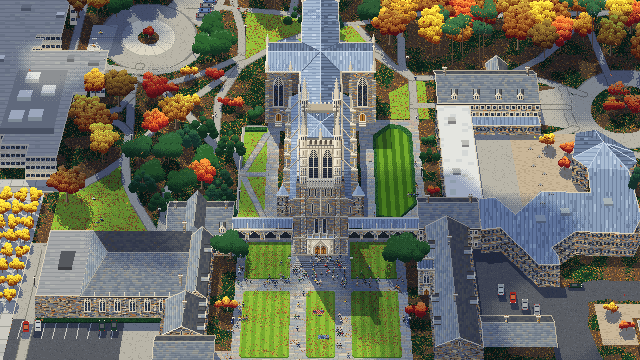
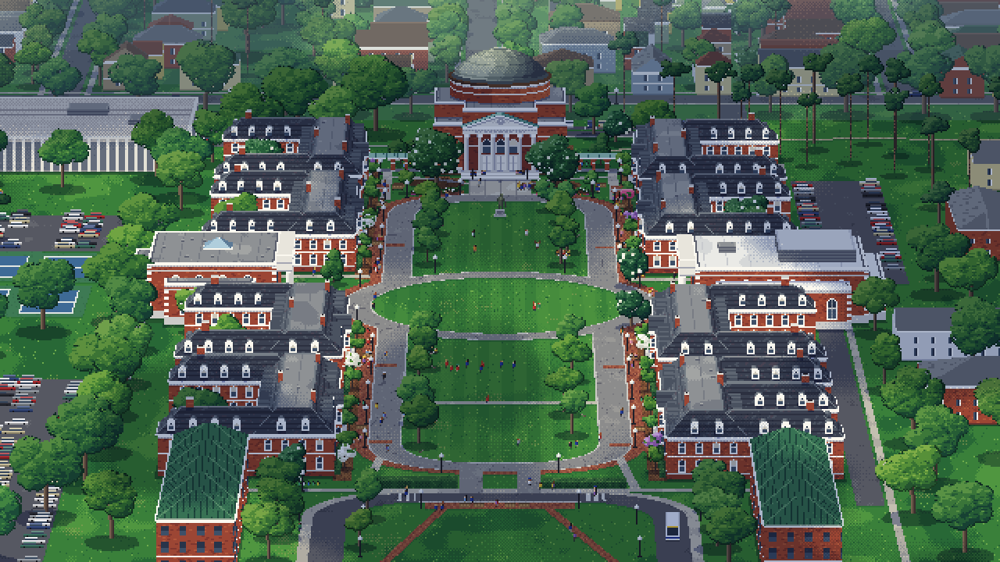
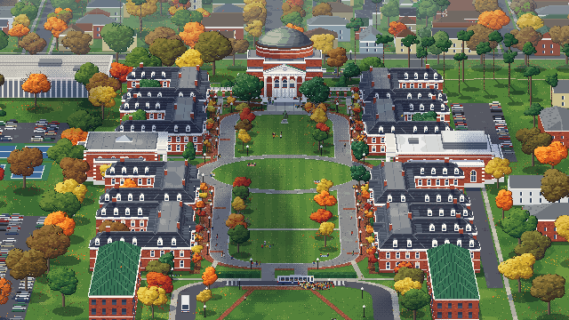

<p align="center">
  
</p>

<h1 align="center">Duke Wallpaper</h1>

<p align="center"><b>Duke's campus, alive behind your desktop icons.</b></p>

<p align="center"><i>An animated pixel-art live wallpaper for Windows and macOS</i></p>

<p align="center">
  
</p>

## The idea

A desktop wallpaper is a photo you stop seeing after a day. Duke Wallpaper replaces it with a living
640x360 pixel-art scene of campus that follows the real world outside: the season, the time of day and
the weather. The chapel gets snow in January, leaves turn in October, and the lamps come on at dusk.

## What you get

1. **Two scenes:** Duke Chapel from high above its court, or a long view up East Campus to Baldwin
   Auditorium. Every building is laid out from real maps and drawn entirely by code.
2. **A campus that lives:** students pour out at class change, crowd the East Campus bus stop and
   board the buses, play frisbee and volleyball on the lawns, and build snowmen when it snows.
3. **Real seasons, time and weather:** cast shadows follow the sun, rain darkens the stone and leaves
   puddles, lightning strikes the spires, and at night the tower is floodlit and the stained glass glows.
4. **Out of your way:** it sits behind your icons, stops drawing whenever nobody can see it (covered
   desktop, locked screen, display off, on battery) and uses no GPU.

<table>
  <tr>
    <td></td>
    <td></td>
  </tr>
  <tr>
    <td></td>
    <td></td>
  </tr>
</table>

## One click to control it

Click the chapel-tower icon in the tray or menu bar to pick the scene and pin a season, the weather or
the time of day, with a live preview. Choices are saved straight away.

<p align="center">
  
</p>

## Get it running

You need [Rust](https://rustup.rs). Then, on Windows:

```
cargo run --release -p duke-windows
```

or on macOS:

```
cargo run --release -p duke-mac
```

Tick **Start with Windows** (or **Open at login**) in the panel to keep it running after a restart.

## Learn more

- **[Technical documentation](documentation.md):** the art, configuration, how it gets behind the
  desktop icons, troubleshooting and uninstalling.
- **[Scene key](docs/chapel-key/):** a numbered map of every building and feature in the chapel scene.

> Duke Wallpaper is a fan project and is not affiliated with or endorsed by Duke University.
