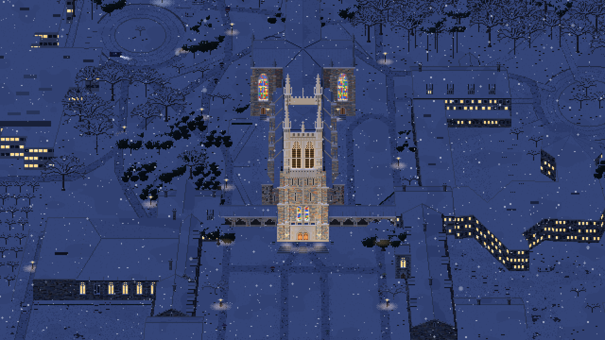
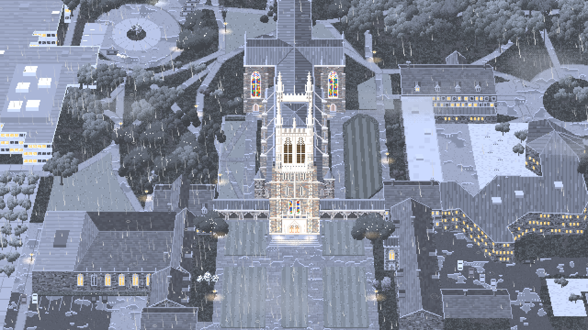
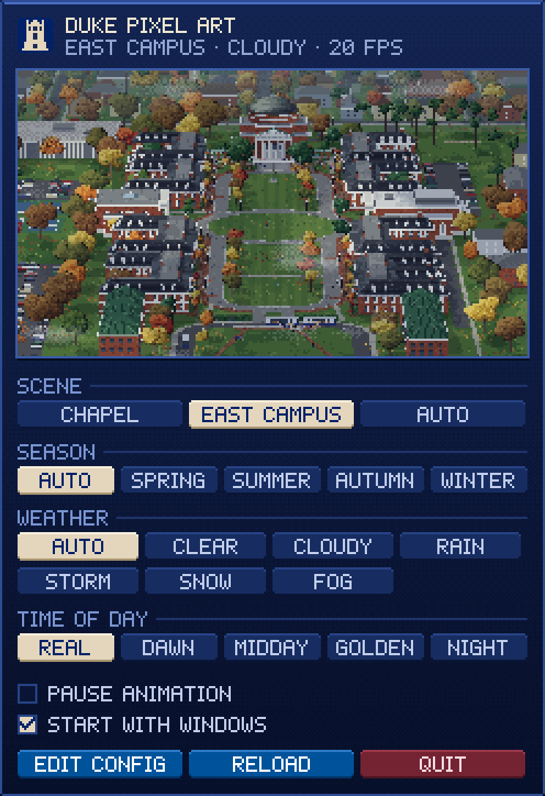

  

<h1 align="center">Duke Wallpaper</h1>

<b>Duke's campus, alive behind your desktop icons.</b>

<i>An animated pixel-art live wallpaper for Windows and macOS</i>

  
  &nbsp;
  

Free · Windows 10 or 11 · macOS 11 or later · <a href="#download">install notes</a>

  

## The idea

A desktop wallpaper is a photo you stop seeing after a day. Duke Wallpaper replaces it with a living
640x360 pixel-art scene of campus that follows the real world outside: the season, the time of day and
the weather. The chapel gets snow in January, leaves turn in October, and the lamps come on at dusk.

## What you get

1. **Two scenes:** Duke Chapel from high above its court, or a long view up East Campus to Baldwin
   Auditorium. Every building is laid out from real maps and drawn entirely by code.
2. **A campus that lives:** students pour out at class change, crowd the East Campus bus stop and
   board the buses, play frisbee and volleyball on the lawns, and build snowmen when it snows.
3. **Real seasons, time and weather:** cast shadows follow the sun, rain darkens the stone and leaves
   puddles, lightning strikes the spires, and at night the tower is floodlit and the stained glass glows.
4. **Out of your way:** it sits behind your icons, stops drawing whenever nobody can see it (covered
   desktop, locked screen, display off, on battery) and uses no GPU.

<table>
  <tr>
    <td></td>
    <td></td>
  </tr>
  <tr>
    <td></td>
    <td></td>
  </tr>
</table>

## One click to control it

Click the chapel-tower icon in the tray or menu bar to pick the scene and pin a season, the weather or
the time of day, with a live preview. Choices are saved straight away.

  

## Download

  <a href="https://github.com/Prorickey/duke-wallpaper/releases/latest/download/DukeWallpaper-Windows-Setup.exe"><b>Download for Windows</b></a>
  &nbsp;·&nbsp;
  <a href="https://github.com/Prorickey/duke-wallpaper/releases/latest/download/DukeWallpaper-macOS.dmg"><b>Download for macOS</b></a>

- **Windows 10 or 11:** run the installer. If SmartScreen says it protected your PC, choose **More info**,
  then **Run anyway**.
- **macOS 11 or later:** open the disk image and drag **Duke Wallpaper** into **Applications**. The first
  time you open it, macOS says it cannot verify the app: open **System Settings > Privacy & Security**
  and choose **Open Anyway**.

Tick **Start with Windows** (or **Open at login**) in the panel to keep it running after a restart. Every
version is on the [releases page](https://github.com/Prorickey/duke-wallpaper/releases).

## Learn more

- **[Technical documentation](documentation.md):** the art, configuration, building from source, how it gets behind the
  desktop icons, troubleshooting and uninstalling.
- **[Scene key](docs/chapel-key/):** a numbered map of every building and feature in the chapel scene.

> Duke Wallpaper is a fan project and is not affiliated with or endorsed by Duke University.
