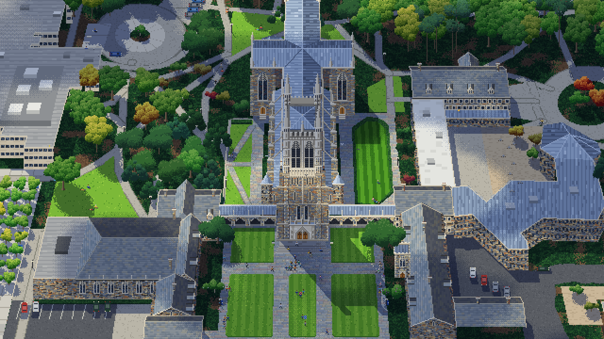
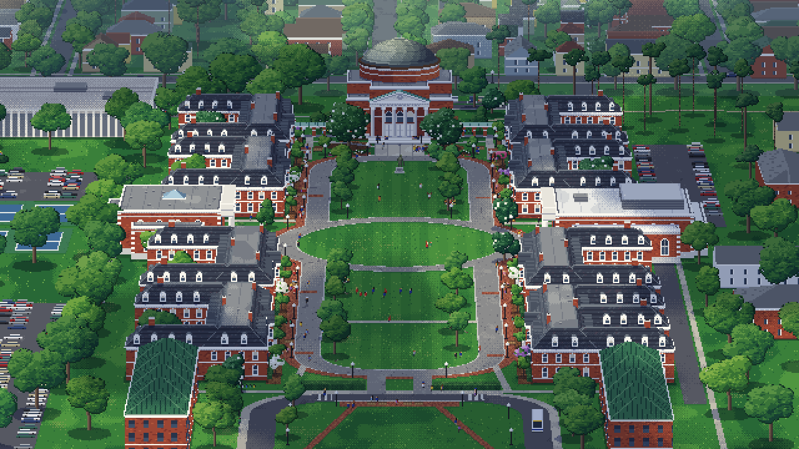
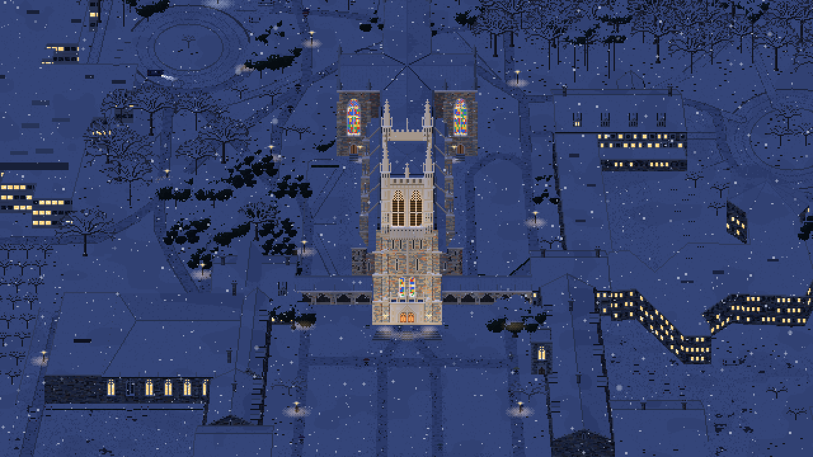
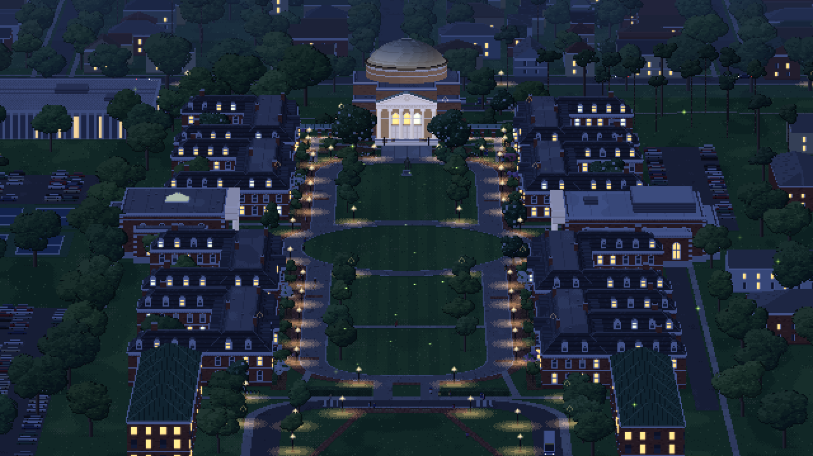
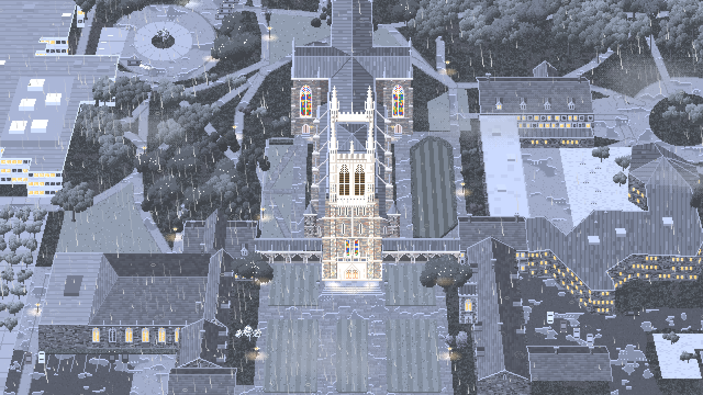
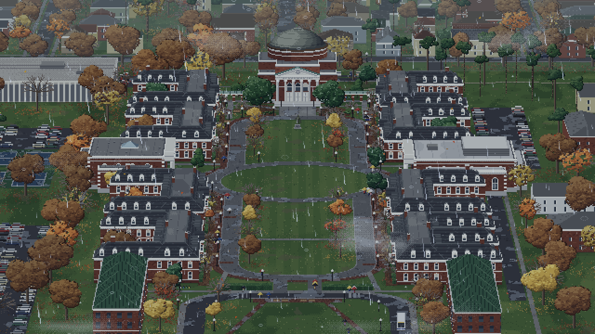
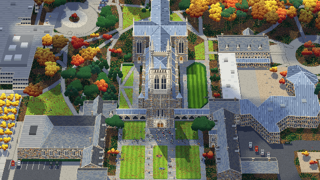
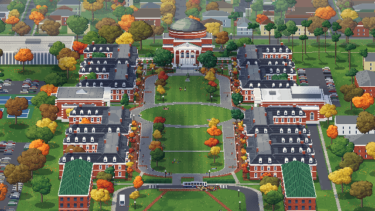
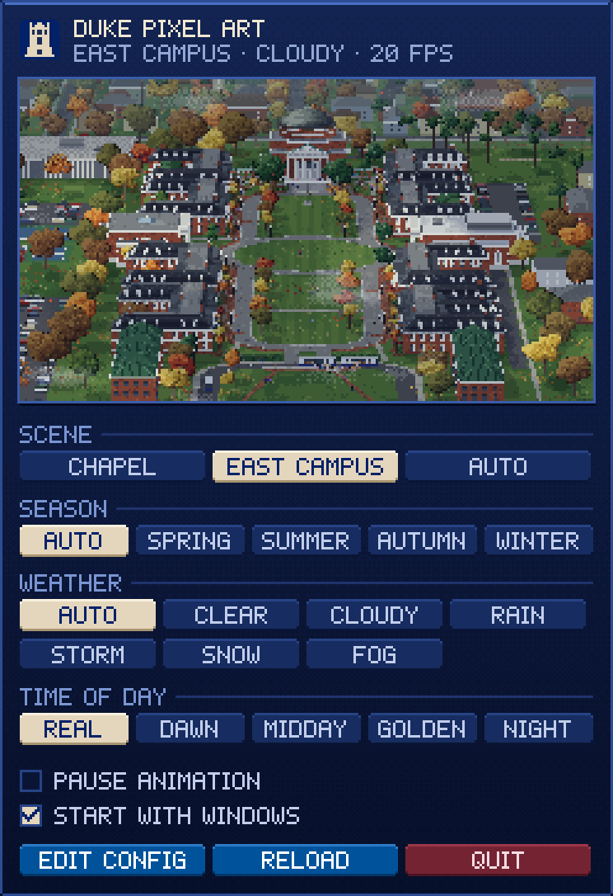

# Duke Wallpaper: Technical Documentation

**Duke's campus, alive behind your desktop icons.** Back to the [project page](README.md).

## Overview

Duke Wallpaper is an animated pixel-art live wallpaper for Windows and macOS.
It draws a 640x360 scene of Duke's campus behind your desktop icons - Duke
Chapel or East Campus - with the real season, time of day and simulated
weather: leaves turn in autumn, snow settles in winter, lamps and windows come
on at dusk, thunderstorms roll through in summer.

It is a single small program with a tray (or menu bar) icon. No installer,
no services, no GPU requirements, and it stops drawing whenever nobody can
see it.

## Contents

- [Art](#art)
- [Requirements](#requirements)
- [Build and run](#build-and-run)
- [Control panel](#control-panel)
- [Configuration](#configuration)
- [How it works](#how-it-works)
- [Troubleshooting](#troubleshooting)
- [Uninstall](#uninstall)
- [License](#license)

## Art

Both scenes are original pixel art drawn entirely by code (no photo is traced,
quantized or shipped). Each is a drone's-eye view with no sky in frame, laid
out from OpenStreetMap footprints and checked against satellite imagery.

| Duke Chapel | East Campus |
| --- | --- |
|  |  |
|  |  |
|  |  |
|  |  |

**Duke Chapel** (`duke_core::chapel`): a steep look down onto the chapel from high
in front of it. The 210 ft tower stands on the centre line with its portal,
belfry and four spires, in multi-hued Duke stone with limestone trim, in front
of the cross-shaped lead roofs of the nave, transepts and chancel. Around it,
as mapped: the arcades, Page Auditorium and Flowers, the Bryan Center and its
plaza, the wooded west garden and drop-off circle, the Gray Building and the
Divinity School with Goodson Chapel, the hedged lawn, and the flagstone court
with its five striped lawn panels. `docs/chapel-key/` holds a
numbered key to every building and feature in frame.

**East Campus** (`duke_core::east`): a long, shallow view north up the quad to
Baldwin Auditorium - slate dome on its brick drum, six-column portico and
copper roofs. All ten buildings lining the quad are in frame (Pegram,
Alspaugh, Lilly Library, Giles and Carr on the west; Bassett, Brown, the East
Campus Union, Wilson and Friedl on the east), with the B. N. Duke statue, the
three lawns, the bus stop plaza on the entrance loop, Jarvis and East House,
and Trinity Park beyond Baldwin.

Each scene reacts to the environment it is given:

- **Seasons**: spring blossom, deep summer green, autumn that turns and drops
  species by species, bare winter branches and dormant lawns.
- **Ground state**: snow builds up on lawns, roofs and trees and is trampled
  along the walks; rain darkens stone and brick and leaves rippling puddles.
- **Time of day**: cast shadows swing with the sun; at night the tower and
  portico are floodlit, stained glass and windows glow, and lamps pool light.
- **Campus life**: trees sway with the wind; people walk the paths in ones,
  twos and groups (with umbrellas in rain and coats in winter), jog, cycle
  and sit on the steps; touch football, volleyball, frisbee and picnics come
  and go on the lawns, replaced by snowball fights and snowmen in snow.
- **Crowds**: at class-change times a crowd pours out onto the chapel steps,
  and the East Campus bus stop fills until the buses - which pull in, open
  their doors and board riders one by one - leave packed.

The `atmosphere` module adds the weather itself: drifting cloud shadows, rain
with gust sheets, forked lightning that strikes the tower spires and tall
trees, layered snowfall, fog, autumn leaves, spring petals, summer fireflies
and passing flocks of birds.

## Requirements

- **Windows** 10 or 11 (both the classic desktop layout and the one
  introduced with Windows 11 24H2 are supported; see
  [Getting behind the icons](#getting-behind-the-icons)).
- **macOS** 11 or later, Apple Silicon or Intel.
- A recent stable Rust (1.87 or newer; developed with 1.95). On Windows, the
  MSVC toolchain; on macOS, the Xcode command line tools.

## Build and run

Windows:

```
cargo run --release -p duke-windows
```

macOS:

```
cargo run --release -p duke-mac
```

That starts the wallpaper on every monitor and puts a small chapel-tower icon
in the notification area (Windows) or the menu bar (macOS). Click it to open
the control panel; **Quit** is at the bottom.

The built program is `target\release\duke-wallpaper.exe` on Windows and
`target/release/duke-wallpaper-mac` on macOS; copy it anywhere you like. On
first run it creates its config file with commented defaults (see
[Configuration](#configuration)). Starting it a second time does nothing
while one copy is already running.

## Control panel

Click the tray or menu bar icon:



| Control | What it does |
| --- | --- |
| Preview | The wallpaper as it is right now, animating while the panel is open (even when windows cover the desktop) |
| **Scene** | Duke Chapel, East Campus, or Auto to cycle between them |
| **Season** | Auto (follows the calendar) or pin Spring / Summer / Autumn / Winter |
| **Weather** | Auto (simulated, drifts over time) or pin Clear / Cloudy / Rain / Storm / Snow / Fog |
| **Time of day** | Real time, or pin Dawn / Midday / Golden hour / Night. An hour fixed in the config file gets its own chip |
| **Pause animation** | Freeze the animation (not remembered across restarts) |
| **Start with Windows** / **Open at login** | Adds or removes a per-user startup entry. Nothing is written unless you tick this |
| **Edit config** | Opens `config.toml` in your text editor |
| **Reload** | Re-reads `config.toml` after you edit it |
| **Quit** | Removes the wallpaper and exits |

The panel is drawn in the same pixel art as the scenes, scaled by a whole
number to suit the display. The highlighted chip in each row is the current
setting. Choices are saved to the config file straight away and the panel
stays open, so several can be changed in a row; click anywhere else, click
the icon again or press `Esc` to close it. A choice is applied on top of the
file as it is at that moment, so edits you made by hand and have not
reloaded yet are kept rather than overwritten. Changing the scene dissolves
to it with an ordered-dither wipe, so every pixel on screen is always a real
art pixel from one scene or the other.

## Configuration

`config.toml`, created on first run in:

- Windows: `%APPDATA%\duke-pixel-art-background\`
- macOS: `~/Library/Application Support/duke-pixel-art-background/`

Edit it with **Edit config** and then choose **Reload**. A missing, unknown
or invalid entry never stops the wallpaper: the default is used and a warning
is written to the log. If the file cannot be parsed at all, the next change
made from the panel keeps a copy of it as `config.toml.bak` before
rewriting.

| Key | Default | Values |
| --- | --- | --- |
| `scene` | `"auto"` | `"chapel"`, `"east"`, `"auto"` (cycle) |
| `cycle_minutes` | `15` | Minutes between scene changes when `scene = "auto"` |
| `transition_seconds` | `2.0` | Length of the dissolve between scenes; `0` = hard cut |
| `season` | `"auto"` | `"auto"` (calendar), `"spring"`, `"summer"`, `"autumn"`, `"winter"` |
| `weather` | `"auto"` | `"auto"` (simulated), `"clear"`, `"cloudy"`, `"rain"`, `"storm"`, `"snow"`, `"fog"` |
| `weather_minutes` | `12` | With automatic weather: roughly how long a spell lasts |
| `time` | `"real"` | `"real"` (system clock), `"dawn"`, `"midday"`, `"golden"`, `"night"`, or an hour as a number such as `17.5` |
| `seed` | `1924` | World seed: the same seed gives the same trees and weather |
| `fps` | `20` | Frames per second, 5-60 |
| `fit` | `"cover"` | `"cover"`: smallest whole-number scale that fills the monitor, centred, edges cropped. `"contain"`: largest whole-number scale that fits, centred, letterboxed |
| `letterbox_color` | `"#0b0e14"` | Colour of the bars around a `"contain"` image, `"#rrggbb"` or `"#rgb"` |
| `pause_on_fullscreen` | `true` | Stop animating a monitor while a maximized or fullscreen window covers it |
| `pause_on_battery` | `false` | Stop animating while on battery power |

Scaling is always by a whole number with nearest-neighbour sampling, so art
pixels stay square and crisp. A 1920x1080 monitor shows the canvas at exactly
x3, 2560x1440 at x4, 3840x2160 at x6. Other shapes crop (`cover`) or
letterbox (`contain`).

## How it works

### Crates

```
crates/
  duke-core     everything that is not operating-system code:
                  Canvas, colours, randomness, Environment, the Scene trait
                  chapel/       the Duke Chapel scene
                  east/         the East Campus scene
                  atmosphere/   weather, season and time simulation and every
                                effect drawn around a scene
                  wallpaper/    engine, config, clock, log, fit, the control
                                panel and its pixel font, menu choices and
                                the rules for when to pause
  duke-windows  the Windows host (Win32); builds duke-wallpaper.exe
  duke-mac      the macOS host (AppKit); builds duke-wallpaper-mac
```

Both hosts only put pixels on screen, listen to the system and forward
clicks; what to draw, what the panel looks like and what a click means all
live in `duke-core`, so the two behave the same.

One frame:

1. `WallClock` from local time, `Controls` from the config and panel choices.
2. `environment = atmosphere.step(seconds_elapsed, &wall_clock, &controls)` -
   advance the simulation.
3. `atmosphere::compose_frame(scene, &mut atmosphere, &environment, &mut frame)` - scene in
   neutral light, cloud shadows, time-of-day colour grade, emissive lights,
   then weather overlays.
4. The host scales the 640x360 frame onto each monitor.

The source carries no comments: names say what things are, and the reasons
that names cannot carry are written down in this section.

### Inside `duke-windows`

| Module | Role |
| --- | --- |
| `host::wallpaper` | From start-up to shutdown: the one window procedure, the main loop, attaching, drawing a frame, panel choices |
| `host::desktop` | Reading Explorer's desktop window hierarchy and becoming a child of it at the right depth |
| `host::control_panel_window` | The panel's popup window: placed above the taskbar next to the icon, scaled to the monitor's DPI, rounded corners and a drop shadow |
| `host::power` | Where the reasons not to render come from (lock, display, suspend, battery, covering windows) |
| `host::blit`, `host::pacing`, `host::monitors`, `host::tray` | Drawing, sleeping between frames, monitors, tray icon |
| `host::single_instance`, `host::start_with_windows` | One instance; the startup registry value |
| `host::win32` | Small helpers shared by the above |

### Getting behind the icons

Explorer's desktop is a window called `Progman`. Sending it the undocumented
message `0x052C` (with the arguments `0xD, 1` on current Windows, `0, 0` on
older ones) makes it split the wallpaper off into a `WorkerW` window so
something can be slipped in between wallpaper and icons. Where everything
ends up depends on the Windows version, so the layout is detected at runtime:

- **Classic** (Windows 8 to Windows 11 23H2): the icons move into one
  top-level `WorkerW`, and the wallpaper is the next `WorkerW` behind it. The
  wallpaper window becomes a child of that second one.
- **Raised desktop** (Windows 11 24H2 and later): icons (`SHELLDLL_DefView`)
  and the wallpaper `WorkerW` are both children of `Progman`, which no longer
  has a drawing surface of its own. The wallpaper window becomes a *layered*
  child of `Progman`, placed directly below the icons and above the
  `WorkerW`.
- **Fallback**: if no `WorkerW` appears, a child of `Progman` below the icons.

One window is attached per monitor. Details that matter:

- **Layered, and layered first.** Under a `Progman` without a surface an
  ordinary child window is simply never shown (measured: nothing is drawn),
  so the window must have `WS_EX_LAYERED`. The style is set while the window
  is still a hidden top-level window and only then is it re-parented; a
  layered *child* is only allowed for programs that declare Windows 8 or
  later, which is what the manifest embedded by `build.rs` does (it also
  makes the process per-monitor DPI aware, so all coordinates are physical
  pixels).
- **Depth is checked, not assumed.** Explorer recreates its `WorkerW` when
  the wallpaper setting changes and its icon view after some restarts, so
  the siblings are looked up afresh each time, and the window is put back
  directly below the icons whenever it is found anywhere else. Moving and
  resizing never touch depth, so a display change can never lift the
  wallpaper over the icons.
- **One routine keeps it right.** Every two seconds, and shortly after any
  hint that something changed (Explorer announcing a new taskbar with the
  `TaskbarCreated` message, a display change, waking from sleep, one of the
  windows being destroyed), the same routine compares the windows with the
  desktop and the monitors as they are now: it attaches from scratch if the
  desktop, the parent or the set of monitors is different, moves a window
  that no longer covers its monitor exactly (Explorer may rearrange the
  desktop after a rotation is announced), and repairs depth. Attaching is
  all or nothing and is retried every three seconds until it succeeds.
- **Leaving.** In the raised layout the window was its own layer above the
  wallpaper, so destroying it is enough. In the older layouts it was drawn
  inside the window the shell paints the wallpaper into, which does not
  repaint by itself: it is asked to, and the system is told to reload the
  current wallpaper (a null path, with nothing written to the profile). Your
  wallpaper setting is never changed.

### The main loop

Everything runs on one thread. The single window procedure does no work: it
turns messages into events on a queue, because messages can arrive while the
program is in the middle of a call into Explorer. The main loop drains the
queue, takes one turn (events, desktop check, housekeeping, a frame if one
is due) and sleeps until the next deadline or message.

- The control window that receives broadcasts is a real hidden top-level
  window, not a message-only one: `TaskbarCreated` and display change
  broadcasts only reach top-level windows.
- The sleep is a high-resolution waitable timer plus the message queue. That
  gives sub-millisecond wake-ups without raising the system timer rate. It
  wakes for unread input too: being a child of an Explorer window joins the
  two threads' input queues, and sleeping on unread input would stall the
  desktop. An event that arrives during a turn is handled before sleeping.
- Reasons not to render are independent flags (paused, session locked,
  display off, suspending, on battery), so the order in which "back" events
  arrive does not matter. An unlock also clears "display off" and
  "suspending", and the display coming on clears "suspending", so a single
  lost notification cannot freeze the wallpaper. The lock state and power
  source are additionally read back from Windows every five seconds, since
  they are facts that can simply be asked for.
- The tray icon is added again whenever Explorer announces a new taskbar,
  and retried every two seconds if Windows refused it (typical at logon).
- The control panel window queues its mouse, keyboard and focus messages on
  the same queue. While it is open the scene keeps rendering so the preview
  stays live; it closes when another window takes the focus.
- A panic (a bug in a scene, say) is written to the log; the wallpaper
  windows and tray icon are still removed and the exit code is 1.

### Drawing

The canvas's `0x00RRGGBB` words are, byte for byte, a 32-bit top-down bitmap,
so each frame goes to GDI unconverted: one `StretchDIBits` call per monitor
in `COLORONCOLOR` mode (pixel replication), with the whole scaled image as
the destination and GDI clipping it to the window. The whole frame is sent
every time: across the 28 standard shots the bounding box of the pixels that
change between two frames covers more than 96% of the canvas in 26 of them,
so tracking a changed rectangle saved nothing.

### Staying cheap

- A fixed frame rate (20 by default); the thread sleeps between frames and
  never spins (the log's statistics line counts loop turns next to frames).
- The scene is rendered once per frame and reused for every monitor.
- No rendering at all while the session is locked, the display is off, the
  system is suspending, the wallpaper is paused, optionally on battery, and
  for monitors hidden behind a maximized or fullscreen window.

Measured on a laptop on battery (8 logical cores, 1920x1200 panel at 125%,
release build, every pixel repainted at 20 fps): 19.9 fps, about 4.3 ms to
render a frame and 0.4 ms to put it on screen, 218 loop turns for 198 frames,
roughly 10% of one core (1.3% of the whole CPU). With the session locked it
rendered nothing and took 4 loop turns in ten seconds; with the desktop
covered by a maximized window it renders nothing and wakes twice a second to
see whether that is still so. The statistics line written to the log every
ten minutes shows the figures on your machine.

### Inside `duke-mac`

| Module | Role |
| --- | --- |
| `host` | Start-up, the main loop and panel choices |
| `host::desktop_windows` | One borderless window per screen at the desktop window level (below the icons), on every Space, ignoring the mouse |
| `host::panel_window` | The control panel, opened under the menu bar icon |
| `host::images` | Turning a canvas into a `CGImage` for a Core Animation layer; the menu bar icon |
| `host::system` | Local time, lock and display-sleep state, battery, the single-instance lock file, the login item, opening the config |

- The 640x360 frame becomes the contents of a layer with nearest-neighbour
  magnification, sized to a whole number of device pixels per art pixel
  (Retina included), so the art stays crisp.
- The program is a menu bar accessory (no Dock icon). It pumps AppKit events
  itself and sleeps until the next frame or event, like the Windows loop.
- A screen is treated as covered when macOS reports its window as fully
  occluded; lock, display sleep and battery are read every five seconds.
- **Open at login** writes a LaunchAgent,
  `~/Library/LaunchAgents/edu.duke.pixel-art-background.plist`, that starts
  this program; unticking deletes it.

## Troubleshooting

**Log.** `duke-wallpaper.log` next to the config (it rolls over to
`duke-wallpaper.log.old` at 256 KB). It records the detected layout, where
each window was attached, every reason rendering stopped or resumed, config
warnings and performance figures.

| Symptom | Things to try |
| --- | --- |
| Nothing visible, static wallpaper still showing | Look at the log and send it with a bug report |
| Animation stops when a window is maximized | That is `pause_on_fullscreen`; set it to `false` if you can see the desktop through or around the window |
| Animation stopped and never resumed | The panel's subtitle and the log give the reason (paused, session locked, on battery, ...) |
| The picture is cropped a lot | `fit = "cover"` fills the screen at a whole-number scale, so monitors that are not 16:9 (and portrait ones especially) lose the edges; `fit = "contain"` shows everything, letterboxed |
| Wallpaper gone after Explorer crashed | It re-attaches within a few seconds; if not, see the log |
| Tray icon missing | It may be in the overflow area (the `^` arrow); drag it out to keep it visible |
| Icons hidden | Windows itself hides them: right-click the desktop, View, Show desktop icons |

Known limits: two windows snapped side by side do not count as "covering" the
desktop, so the wallpaper keeps animating behind them; when Windows changes
its own wallpaper (a slideshow or Spotlight), the static picture can show
through for up to two seconds before the depth is repaired.

## Uninstall

1. Quit: icon, **Quit**.
2. If you enabled **Start with Windows** / **Open at login**, untick it
   before quitting, or remove the entry afterwards:
   - Windows:
     ```
     reg delete "HKCU\Software\Microsoft\Windows\CurrentVersion\Run" /v DukePixelArtBackground /f
     ```
   - macOS: delete `~/Library/LaunchAgents/edu.duke.pixel-art-background.plist`.
3. Delete the config and log folder (see [Configuration](#configuration)).
4. Delete the program.

Nothing else is written anywhere.

## License

MIT, see [LICENSE](LICENSE).

Duke Wallpaper is a fan project and is not affiliated with or endorsed by Duke University.
